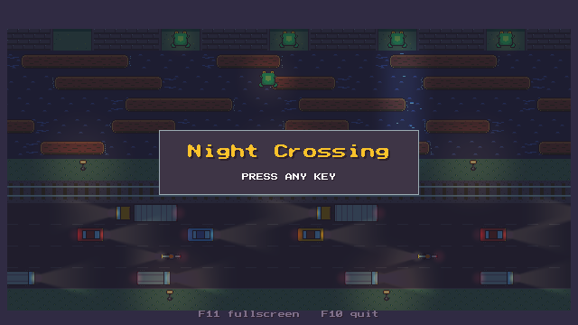
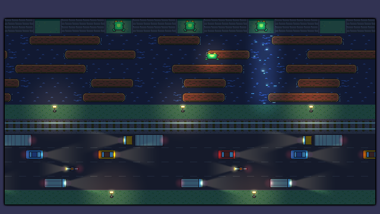
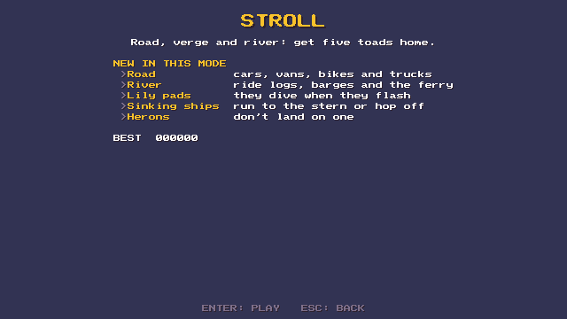
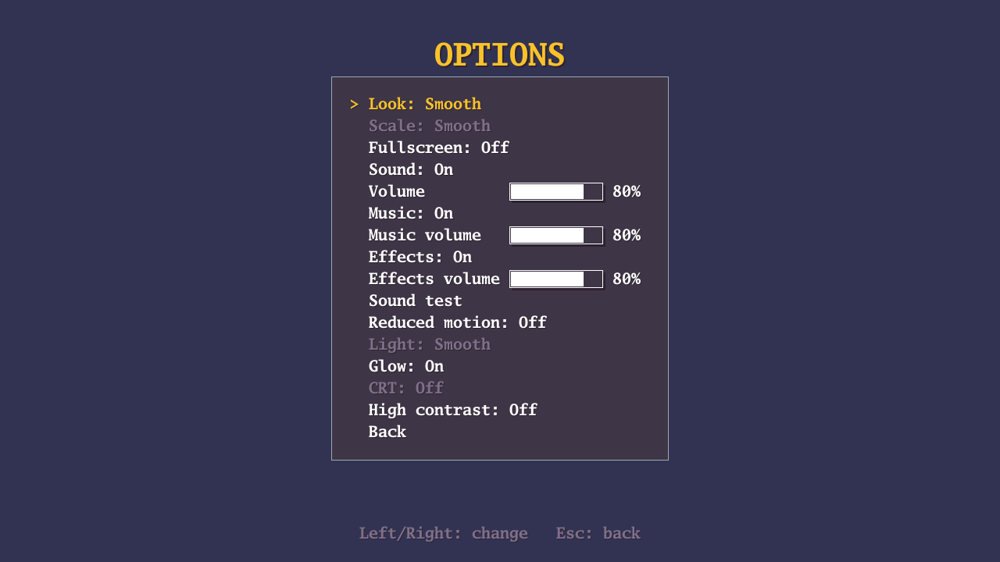

# Night Crossing

An arcade lane-crossing game. A toad crosses the edge of town at night, over
a busy road, a railway and a river, to five nooks on the far bank.





## How to play

- Hop one cell at a time. Cars, vans, bikes and trucks squash you on the road.
- On the river, ride the logs, barges and the ferry. The water is deadly, and
  so is being carried off the edge.
- Lily pads dive when they flash. Ships sink, bow first: run to the stern or
  hop off. Never land on a heron.
- Fill all five nooks before the clock runs out to clear the level. After
  level 8 the last levels loop, faster each time round.

Points: 10 for each new row reached, 100 for a nook plus 10 for each second
left, 1000 for the fifth nook. An extra life every 20,000.

## Modes

- **Stroll:** the game above.
- **Last Train:** Stroll, plus:
  - **Trains.** When the crossing lights flash and the bell rings, a train
    is coming: stay off the track until it has passed. Each level the
    trains get faster and come more often.
  - **A hop combo,** from level 2. Keep hopping forward for x2, x3 and x4
    points, on the hops and the nook. Waiting too long, hopping back or
    dying ends it; riding a log or a boat keeps it.
  - **Day and night,** from level 3. Each level runs from dawn to night as
    you fill the nooks.
- **Rush Hour:** Last Train, plus the road in bad weather:
  - **Rush hour waves.** When a lane's traffic light turns amber, then red,
    a wave of traffic is coming down it. It always leaves a way across.
  - **Fog,** from level 2. It hides the cars inside it, but not their
    headlights.
  - **Rain,** from level 3. A hop that lands on the road slides one more
    cell the same way: plan for it.
- **Storm:** Rush Hour, plus the river in a storm, under an overcast sky
  with lightning:
  - **Currents.** Arrows on the water show a current. Standing on a log or
    a boat in that row, you slide along it: hop back before you slide off.
  - **Gusts,** from level 2. "GUSTS FROM THE WEST" (or east): through the
    spell, the wind pushes you one cell that way every few seconds, with
    streaks building just before each push. Stand where a push is safe.
  - **Floods,** from level 3. Stretches of the verge show puddles, then go
    under for a while, and the river runs faster until the water drains.



## Controls

| | Keyboard | Gamepad |
|---|---|---|
| Hop | Arrow keys or WASD | D-pad or left stick |
| Choose | Enter or Space | A |
| Back | Esc or Backspace | B |
| Pause | Esc or P | Start |
| Restart the game | Ctrl+R | |
| Quit to the menu | Ctrl+M | Select |
| Sound on/off | Ctrl+S | |
| Fullscreen | F11 or Alt+Enter | |
| Quit | F10 | |

## Options

Fullscreen, sound, music and effects with their volumes, a sound test, reduced
motion, smooth or pixel light, glow, a CRT look and high contrast (outlined
hazards and a lighter night).



Settings and high scores are saved as `settings.json` and `scores.json` next
to the game.

## Building

Needs Go 1.27 or later.

```sh
go run ./cmd/nightcrossing                 # run the game
go run ./cmd/nightcrossing -seed 42        # with a fixed random seed
go vet ./...
go test ./...
```

**Windows** (no cgo):

```sh
CGO_ENABLED=0 GOOS=windows GOARCH=amd64 go build -ldflags "-H=windowsgui" -o bin/nightcrossing.exe ./cmd/nightcrossing
```

**Linux** (amd64) needs cgo and the X11/GL/ALSA development packages. On
Debian or Ubuntu:

```sh
sudo apt-get install libgl1-mesa-dev libxcursor-dev libxi-dev libxinerama-dev libxrandr-dev libxxf86vm-dev libasound2-dev pkg-config
go build -o bin/nightcrossing ./cmd/nightcrossing
```

**For development:**

```sh
go run -tags debug ./cmd/nightcrossing             # debug overlay
go run ./cmd/nightcrossing -level 38               # start games on level 38 (no scores kept)
go run -tags debug ./cmd/nightcrossing -noshaders  # draw as if shaders were unavailable
go generate ./assets                               # rebuild the sprite sheets
```

## Credits

- Colours: the [Resurrect 64](https://lospec.com/palette-list/resurrect-64)
  palette by Kerrie Lake.
- Built with [Ebitengine](https://ebitengine.org), from the
  [gameskeleton](https://github.com/comprofix/gameskeleton) template.
- All art, music and sound are original and made for this game; the music and
  sound are made in code.

## License

MIT. See [LICENSE](LICENSE).
